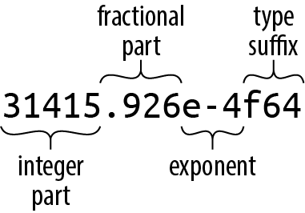
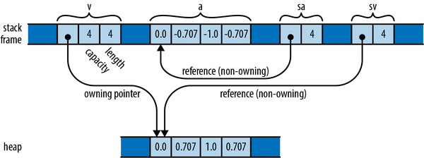
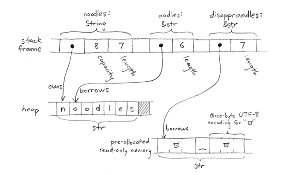

# Fundamental Types

Rust type inference: these two definitions are exactly equivalent, and Rust will generate the same machine code either way:

```rust
fn grade_cutoffs(tier_size: u32) -> Vec<u32> {
    let mut cutoffs: Vec<u32> = Vec::<u32>::new();
    for tier in 1u32..5u32 {
        cutoffs.push(100u32 - tier * tier_size);
    }
    cutoffs
}


// fn grade_cutoffs(tier_size: u32) -> Vec<u32> {
    let mut cutoffs = Vec::new();
    for tier in 1..5 {
        cutoffs.push(100 - tier * tier_size);
    }
    cutoffs
}
```

Type inference gives back much of the legibility of dynamically typed languages, while still catching type errors at compile time 🤷‍♀️.

| Type                                               | Description                                                                          | Example values                                                          |
| -------------------------------------------------- | ------------------------------------------------------------------------------------ | ----------------------------------------------------------------------- |
| `i8`, `i16`, `i32`, `i64`, `i128`                  | Signed integers of the specified bit width                                           | `42`, `-5i8`, `0o100i16`                                                |
| `u8`, `u16`, `u32`, `u64`, `u128`                  | Unsigned integers of the specified bit width                                         | `0x400u16`, `20_922_789_888_000u64`, `b'*'` (`u8` byte literal)         |
| `isize`, `usize`                                   | Signed and unsigned integers with the same width as a pointer on the target platform | `137usize`, `-0b0101_0010_isize`, `0xffff_fc00_usize`                   |
| `f32`, `f64`                                       | IEEE 754 floating-point numbers: single and double precision                         | `1.0`, `3.14159f32`, `6.0221e23`                                        |
| `bool`                                             | Boolean                                                                              | `true`, `false`                                                         |
| `(char, u8, i32)`                                  | Tuple; elements may have different types                                             | `('%', 0x7fu8, -1i32)`                                                  |
| `()`                                               | Unit type: the empty tuple                                                           | `()`                                                                    |
| `struct S { x: f32, y: f32 }`                      | Struct with named fields                                                             | `S { x: 120.0, y: 209.0 }`                                              |
| `struct T(i32, char);`                             | Tuple struct                                                                         | `T(120, 'X')`                                                           |
| `struct E;`                                        | Unit-like struct with no fields                                                      | `E`                                                                     |
| `enum Attend { OnTime, Late(u32) }`                | Enum; variants may carry data                                                        | `Attend::Late(5)`, `Attend::OnTime`                                     |
| `Box<Attend>`                                      | Owning pointer to a heap-allocated value                                             | `Box::new(Attend::Late(15))`                                            |
| `&i32`, `&mut i32`                                 | Shared and mutable references; cannot outlive the referenced value                   | `&42i32`, `&mut 42i32`                                                  |
| `String`                                           | Owned, growable UTF-8 string                                                         | `"ラーメン: ramen".to_string()`                                         |
| `&str`                                             | Borrowed UTF-8 string slice                                                          | `"そば: soba"`, `&text[..]`                                             |
| `char`                                             | Unicode scalar value; occupies 32 bits                                               | `'*'`, `'\n'`, `'字'`, `'\x7f'`, `'\u{CA0}'`                            |
| `[f64; 4]`, `[u8; 256]`                            | Fixed-length array; all elements have the same type                                  | `[1.0, 0.0, 0.0, 1.0]`, `[b' '; 256]`                                   |
| `Vec<f64>`                                         | Owned, growable vector; all elements have the same type                              | `vec![0.367, 2.718, 7.389]`                                             |
| `&[u8]`, `&mut [u8]`                               | Shared and mutable slice references; contain a pointer and a length                  | `&bytes[10..20]`, `&mut bytes[..]`                                      |
| `Option<&str>`                                     | Optional value: `Some(value)` or `None`                                              | `Some("Dr.")`, `None`                                                   |
| `Result<u64, std::io::Error>`                      | Success containing a value, or failure containing an error                           | `Ok(4096)`, `Err(std::io::Error::last_os_error())`                      |
| `&dyn std::error::Error`, `&mut dyn std::io::Read` | References to trait objects; provide dynamic dispatch to a trait implementation      | `&err as &dyn std::error::Error`, `&mut file as &mut dyn std::io::Read` |
| `fn(&str) -> bool`                                 | Function pointer                                                                     | `str::is_empty`                                                         |
| No directly writable type name                     | Closure; each closure has its own anonymous type                                     | `\|a: i32, b: i32\| { a * a + b * b }`                                  |

## Numeric Types

- The foundation of Rust’s type system is a collection of fixed-width numeric types, chosen to match the types that almost all modern processors implement directly in **hardware**.
- Fixed-width numeric types can **overflow** or **lose precision**, but they are adequate for most applications and can be thousands of times **faster** than representations like **arbitrary-precision** integers and exact rationals.
- ➡️ C/C‍++ programmers should note that there is no single “character” type used for both text and binary data in Rust. Rust’s `char` type is a **Unicode** character type, **not an integer** type, and is quite different from C’s `char`.
- Rust requires **array indices** to be **usize** values. Values representing the **sizes** of arrays or vectors or **counts** of the number of elements in some data structure also generally have the **usize** type.

> Integer literals in Rust can take a suffix indicating their type: `42u8` is a `u8` value, and `1729isize` is an `isize`. If an integer literal lacks a type suffix, Rust **puts off** determining its type until it finds the value being used in a way that pins it down: stored in a variable of a particular type, passed to a function that expects a particular type, compared with another value of a particular type, or something like that. If the code provides no such clues, Rust defaults to **i32**.

- The prefixes 0x, 0o, and 0b designate hexadecimal, octal, and binary literals.
- To make long numbers more legible, you can insert underscores among the digits: `4_294_967_295` OR `0xffff_ffff` OR even `127_u8`.
- You can convert from one integer type to another using the `as` operator:

```rust
assert_eq!(10_i8 as u16, 10_u16);
assert_eq!(0xcafedad_u64 as u8, 0xad_u8);  // value too big for u8, truncated
```

```rust
println!("{}", (-4).abs()); // Rust complains: error: can't call method `abs` on ambiguous numeric type `{integer}`
```

In cases like this where the type of an integer is **unclear**, Rust usually defaults to i32. In the particular case where we’re calling a **method**, though, it’s an **error**. Rust always needs to know the type of a value before looking up its **methods**. The solution is to spell out which type you intend, either with a suffix or by using a specific type’s function:

```rust
println!("{}", (-4_i32).abs());
println!("{}", i32::abs(-4));
```

> Note that method calls have a **higher precedence** than **unary prefix operators**, so be careful when applying methods to negated values. Without the parentheses around -`4_i32` in the first statement, `-4_i32.abs()` would apply the `abs` method to the positive value 4, producing positive 4, and then negate that, producing -4.

### Handling Integer Overflow

For example, the following function has a surprising bug:

```rust
fn midpoint(lo: i32, hi: i32) -> i32 {
    (lo + hi) / 2
}

// panic: attempt to add with overflow (in debug builds only!)
let m = midpoint(7, i32::MAX);
```

- The midpoint function looks about right, but when called with large enough arguments, (lo + hi) produces a result that is outside of i32’s range. In _Java_, that would “wrap around” to a **negative** number instead. The function would then divide that by two and return an incorrect result. In C or C‍++, integer overflow is undefined behavior.
- In Rust, **debug builds** check the addition and panic on overflow, giving you a chance to notice and fix the problem. In **release builds**, for speed, the checks are disabled by default, and integer arithmetic wraps around, as in Java.
- Because “panic in debug, wrap in release” isn’t always what you want, Rust lets you say explicitly what should happen on overflow:

| Family          | On overflow                            | Example                                   |
| --------------- | -------------------------------------- | ----------------------------------------- |
| `wrapping_*`    | Wraps around (keeps only the low bits) | `500_u16.wrapping_mul(500)` → `53392`     |
| `strict_*`      | Panics, in every build                 | `usize::MAX.strict_mul(2)` → panic        |
| `checked_*`     | Returns `None` instead of a value      | `100_u8.checked_add(200)` → `None`        |
| `saturating_*`  | Stops at the type's min or max         | `32760_i16.saturating_add(10)` → `32767`  |
| `overflowing_*` | Returns the wrapped value plus a flag  | `255_u8.overflowing_add(2)` → `(1, true)` |

A few details from the examples:

- **Wrapping**: 500 × 500 = 250,000, but a `u16` only holds 0 to 65,535. Wrapping means taking the remainder after dividing by 65,536, which is 53,392. The same bits read as a signed `i16` give −12,144, which is why signed wrapping can produce negatives.
- **Checked**: use this when overflow is a real possibility you want to handle in code, since `Option` forces you to deal with the `None` case.
- **Saturating**: useful when "as close as possible" is acceptable, such as audio volume or a pixel's brightness.
- **Division overflow**: an `i8` ranges from −128 to 127. So −128 ÷ −1 should be 128, which doesn't exist in `i8`. It's the one case where division overflows.
- For `<<` and `>>`, the thing that can be out of range is the **shift distance**, not the result. Shifting a 64-bit number by 65 positions isn't meaningful, so the methods apply their behavior to the distance:
  - `10_u64.wrapping_shl(65)` wraps the distance: 65 mod 64 = 1, so it shifts left by 1, giving 20.
  - `10_u64.checked_shr(65)` returns `None`, because 65 is not a valid shift distance for a 64-bit type.

### Floating-Point Types

- Rust floating-point types follow the _IEEE 754_ floating point standard. They include positive and negative infinities, distinct positive and negative zero values, and a not-a-number value.
- **Precision** is how many significant digits you can trust, counted from the **first nonzero digit** regardless of where the decimal point is. An `f32` can hold `1.23456` or `123,456` or `0.00123456` accurately, but if you try to store `123,456,789`, the last few digits get **rounded off**. An `f64` gives you about `15` reliable digits instead of 6. "_First nonzero digit_" means you start counting at the leftmost digit that isn't a zero, because leading zeros only show where the decimal point sits and carry no information about the value.
- **Range** is how large a number can get before it overflows to ♾️. These limits are enormous (the number of atoms in the observable universe is around 10⁸⁰), so in practice you almost never run out of range. Precision is the limit you actually run into 🙁.
- Floating-point literals have the general form :

<p align="center"></p>

- Every part of a floating-point number after the integer part is **optional**, but at least one of the fractional part, exponent, or type suffix must be **present**, to distinguish it from an integer literal.
- The fractional part may consist of a **lone decimal** point, so `5.` is a valid floating-point constant.
- If a floating-point literal **lacks a type suffix**, Rust checks the context to see how the value is used, much as it does for integer literals. The default is `f64`.

```rust
assert!((-1. / f32::INFINITY).is_sign_negative());
```

- Dividing a finite number by ♾️ gives zero, but since a negative was divided by a positive, the result is negative zero, written -`0.0`.
- Floats store the sign in a separate bit from the rest of the number, so zero comes in two versions: `+0.0` and `-0.0`. They compare as equal (0.0 == -0.0 is true), so == can’t tell them apart. `is_sign_negative()` looks directly at the sign bit, and here it returns true.

```rust
assert_eq!(-f32::MIN, f32::MAX);
```

- `f32::MIN` is the most negative finite value, about `−3.4 × 10³⁸`, and `f32::MAX` is the largest positive one, about +3.4 × 10³⁸. Negating a float only flips the sign bit, so the two are exact mirror images, and negating MIN gives exactly MAX.
- This contrasts with the integer passage we have seen earlier. For integers, `i8` ranges from −128 to 127, so there is one more negative value than positive, and `-i8::MIN` **overflows**. Floats don’t have that asymmetry 🤷.

> Unlike C and C‍++, Rust does not perform numeric conversions **implicitly**. If a function expects an `f64` argument, it’s an error to pass an `i32` value as the argument. In fact, Rust won’t even implicitly convert an `i16` value to an `i32` value, even though every `i16` value is in the range of `i32`.

## The bool Type

- Many languages let you put a non-Boolean value where a `true`/`false` is expected and convert it for you. This is often called "**truthiness**."
  - **C and C++**: zero and null pointers count as `false`, everything else as true. So `if (x)` means "if x is not zero," and `if (ptr)` means "if ptr is not null."
  - **Python and JavaScript**: any value at all can be a condition, with each language having its own rules. In Python, an empty list and an empty string are false. In JS, an empty string is false but an empty array is true 🤷‍♀️.
- Rust does no such conversion. The condition must have type `bool`:

```rust
let x = 5;

if x { ... }        // error: expected `bool`, found integer
if x != 0 { ... }   // fine: `x != 0` is a bool
```

- The same goes for `while` conditions and for the operands of `&&` and `||`. "**Short-circuiting** means these operators skip evaluating the right side when the left side already decides the answer: `false && anything` is false without looking further.)
- The rules for truthiness vary by language and are easy to get wrong, as the empty-array difference between Python and JS shows. Requiring a `bool` makes you say what you mean: `x != 0`, `!list.is_empty()`, or `name.len() > 0` each state the exact test. It also catches a classic C bug. In C, `if (x = 0)` assigns 0 to x and then tests it, when the programmer meant `==`. It compiles and silently does the wrong thing. In Rust, an assignment doesn't produce a `bool`, so the same typo is a compile error.
- Rust’s as operator can convert bool values to integer types:

```rust
assert_eq!(false as i32, 0);
assert_eq!(true  as i32, 1);
```

- Although a bool needs only a single bit to represent it, Rust uses an **entire byte** for a **bool** value in memory, so you can create a pointer to it.

## Tuples

Tuples are very different from arrays. For one thing, each field of a tuple can have a different type, whereas an array’s elements must all be the same type. Further, while accessing elements by a variable index, `arr[i]`, is practically the defining feature of arrays, there is no way to do this with a tuple. You can access a field by its numeric “name”, `t.1`, but you can’t write `t.i` or `t[i]` to get the ith field.

Rust code often uses tuple types to return **multiple values** from a function. For example, the `split_at` method on string slices, which divides a string into two halves and returns them both:

```rust
let text = "I see the eigenvalue in thine eye";
let (head, tail) = text.split_at(21);
// OR
let temp = text.split_at(21);
let head = temp.0;
let tail = temp.1;
```

You’ll also see tuples used as a sort of minimal-drama struct type. The type of the bounds parameter is `(usize, usize)`, a tuple of two usize values. Admittedly, we could just as well write out separate _width_ and _height_ parameters, and the machine code would be about the same either way. It’s a matter of clarity. We think of the size as one value, not two, and using a tuple lets us write what we mean.

```rust
fn write_image(
    filename: &str,
    pixels: &[u8],
    bounds: (usize, usize),
) -> Result<(), std::io::Error> {
    ...
}
```

The other commonly used tuple type is the **zero-tuple** `()`. This is traditionally called the **unit type** because it has only one value, also written `()`. Rust uses the unit type where there’s no meaningful value to carry, but context requires some sort of type nonetheless.

For example, a function that returns no value has a return type of ():

```rust
fn sleep(duration: Duration);
// which is shorthand for returning the unit type:
fn sleep(duration: Duration) -> ();
```

## Pointer Types

- Rust has several types that represent memory addresses 🧐. This is unusual in modern programming languages for two reasons.
  - First, in many languages, values do not nest. In Java, for example, if class `Rectangle` contains a field `Vector2D` upperLeft;, then `upperLeft` is a **reference** to another separately created `Vector2D` object. Objects never physically contain other objects in Java❗. The language doesn’t need pointer types because **every Java object** type is implicitly a **pointer type**.
- Rust is different. The language is designed to help keep allocations to a **minimum**, so values nest by default.
  - The value `((0, 0), (1440, 900))` is stored as four adjacent integers. If you store it in a local variable, you’ve got a local variable four integers wide. **Nothing** is allocated in the **heap**. This is great for **memory** efficiency, but as a consequence, whenever a Rust program needs one value to point to another, it must say so by using a pointer type **explicitly**.
- The second reason Rust needs several pointer types is that there’s no GC to manage memory for us. It turns out memory still needs to be managed. Rust programs must decide when to allocate memory, how much to allocate, and when it’s safe to deallocate it. In Rust, these memory management policies are written out in the pointer types themselves.

### `&T` and `&mut T`: borrowing

A reference lets you use a value that someone else owns. It never frees anything; the owner does that. Therefore references have no memory management **overhead** at all.

```rust
let s = String::from("hello");   // s owns the string
let r = &s;                      // r borrows it
println!("{}", r);
// s is freed here, when it goes out of scope; r did nothing
```

- `&T` is a shared reference: **read-only**, and you can have many at once.
- `&mut T` is a **mutable** reference: it can modify the value, but **only one** may exist at a time.

### `Box<T>`: one owner, value on the heap

A `Box` owns a value stored on the heap. When the box goes away, the value is freed.

```rust
{
    let b = Box::new(42);   // allocates heap memory holding 42
    println!("{}", *b);
}   // b goes out of scope, memory is freed
```

👉 Boxes are not needed every day, but they’re the most basic way to override the **default nesting** of values, which is occasionally useful.

The classic case is a recursive type:

```rust
struct Node {
    value: i32,
    next: Option<Box<Node>>,   // a pointer, so Node has a fixed size
}
```

Without the `Box`, a `Node` would contain a `Node`, which would contain a `Node`, and so on, giving it infinite size.

### `Rc<T>` and `Arc<T>`: many owners

Sometimes no single part of the program is the obvious owner. `Rc` allows shared ownership by counting how many pointers exist.

```rust
use std::rc::Rc;

let a = Rc::new(String::from("shared"));   // count = 1
let b = Rc::clone(&a);                     // count = 2, same string, no copy
drop(a);                                   // count = 1
// when b goes away, count = 0 and the string is freed
```

Cloning an `Rc` doesn't copy the data. It makes another pointer to the same value and adds one to the count. This is the closest Rust gets to how Go pointers feel, except that the cleanup is done by counting, not by a GC.

`Arc` ("atomic Rc") does the same thing with a **thread-safe** counter, so it can be shared between threads. It is slightly slower, which is why both exist: you use `Rc` within one thread and `Arc` across threads.

### `*const T` and `*mut T`: raw pointers

These are plain **C-style** pointers with no safety checks. They can be null or point to freed memory, and the compiler won't stop you. Because of that, you can only dereference them inside an `unsafe` block, which marks code where you take responsibility for correctness. They are mostly used for calling C libraries and for building low-level data structures, and most Rust code never touches them.

➡️ All of these types point to a value of type `T`; they differ only in memory management strategies and corresponding rules about **mutability** and **thread safety**.

Java doesn’t need all this variety: the GC provides a convenient, **one-size-fits-all** strategy for managing memory. C‍++ programmers, however, will recognize these as **smart pointer types**, similar to those in the C‍++ standard library: `Box<T>` is like C‍++’s `std::unique_ptr<T>`, and `Arc<T>` is like C‍++’s `std::shared_ptr<T>`.

Except for **raw pointers**, Rust pointer types are **non-nullable**. Use `Option` for optional pointers, with `None` representing null. There’s no extra memory cost; an `Option<&T>` is the same size as a `&T`.

## Arrays, Vectors, and Slices

- Rust has three types for representing a sequence of values in memory:
  - The type `[T; N]` represents a fixed-size array of `N` values, each of type `T`. An array’s size is a constant determined at compile time and is part of the type; you can’t grow or shrink an array.
  - The type `Vec<T>`, called a vector of Ts, is a **dynamically** allocated, growable sequence of values of type `T`. A vector’s elements live in the **heap**, so you can resize vectors at will: push new elements onto them, append other vectors to them, delete elements, and so on.
  - The types `&[T]` and `&mut [T]` are reference types that refer to a **slice**, a **contiguous** subsequence, of a vector or array’s elements.

### Arrays

```rust
let lazy_caterer: [u32; 6] = [1, 2, 4, 7, 11, 16];
let taxonomy = ["Animalia", "Arthropoda", "Insecta"];
// Declares an array of 10,000 bool elements, all set to true. You’ll see this syntax
// used for fixed-size buffers: [0u8; 1024] is a one-kilobyte buffer, filled with zeros.
// Rust has no notation for an uninitialized array.
// -> (In general, Rust ensures that code can never access uninitialized memory.)
let mut sieve = [true; 10000];
```

### Vectors

Despite its fundamental role, `Vec` is an **ordinary** type defined in Rust, not built into the language.

```rust
let mut primes = vec![2, 3, 5, 7];
assert_eq!(primes.iter().product::<i32>(), 210);
// ou can also build a vector by repeating a given value a certain number of times,
// again using a syntax that imitates array literals:
fn new_pixel_buffer(rows: usize, cols: usize) -> Vec<u8> {
    vec![0; rows * cols]
}
// Another possibility is to build a vector from the values produced by an iterator:
let v: Vec<i32> = (0..5).collect();
assert_eq!(v, [0, 1, 2, 3, 4]);
```

If you know the number of elements a vector will need in advance, instead of `Vec::new` you can call `Vec::with_capacity` to create a vector with a buffer large enough to hold them all, right from the start; then, you can add the elements to the vector one at a time without causing any **reallocation**. The `vec!` macro uses a trick like this, since it knows how many elements the final vector will have.

```rust
let mut v = Vec::with_capacity(2);
assert_eq!(v.len(), 0);
assert_eq!(v.capacity(), 2);
```

```rust
let languages: Vec<String> = std::env::args().skip(1).collect();
for l in languages {
    println!(
        "{l}: {}",
        if l.len() % 2 == 0 {
            "functional"
        } else {
            "imperative"
        },
    );
}
```

### Slices

A slice, written `[T]` without specifying the **length**, is a region of an **array** or **vector**. Since a slice can be any length, slices can’t be stored directly in variables or passed as function arguments. They are always passed by **reference**.

A slice reference is a **fat pointer**: a two-word value comprising a pointer to the slice’s first element, and the number of elements in the slice.

```rust
let v: Vec<f64> = vec![0.0,  0.707,  1.0,  0.707];
let a: [f64; 4] =     [0.0, -0.707, -1.0, -0.707];

let sv: &[f64] = &v;
let sa: &[f64] = &a;
```

<p align="center"></p>

An **ordinary** reference points to **one** value; a **slice reference** points to **several values** stored **side-by-side** in memory. Since slice references can point to data whether it’s located in an array or a vector, they’re a good choice when you want to write a function that can operate on either one. For example, here’s a function that prints a slice of numbers, one per line:

```rust
fn print_nums(n: &[f64]) {
    for elt in n {
        println!("{elt}");
    }
}

print_nums(&a);  // works on arrays
print_nums(&v);  // works on vectors

// You can get a reference to a slice of an array or vector,
// or a slice of an existing slice, by indexing it with a range:
print_nums(&v[0..2]);    // print the first two elements of v
print_nums(&a[2..]);     // print elements of a starting with a[2]
print_nums(&sv[1..3]);   // print v[1] and v[2]
```

If our `print_nums` function took its argument as a `&Vec<f64>`, it would be **unnecessarily limited** to **full vectors only**; `&v[0..2]` and so on would not be valid arguments. Where possible, functions should accept **slice references** rather than vector or array references, for generality 👍.

For the same reason, many of the useful standard library methods you’d like to see on arrays and vectors are implemented as methods on slices:

```rust
let mut chaos = vec![3, 5, 4, 1, 2];
chaos.sort();
```

In this example, the `sort` method is actually defined on the slice type `[i32]`, not `Vec<i32>`. Rust once again **automatically** creates a **slice reference** to the vector’s elements, and calls `sort` on that. It would work the same with an array.

## String and Character Types

| Role                                        | C++                | Rust     |
| ------------------------------------------- | ------------------ | -------- |
| Read-only view of text that lives elsewhere | `std::string_view` | `&str`   |
| Owned, growable text buffer                 | `std::string`      | `String` |

### String and Character Literals

You write `\x` followed by exactly two hex digits, and the value must be between `00` and `7F` (0 to 127 in decimal), which is the ASCII range.

```rust
assert_eq!('\x41', 'A');     // 0x41 = 65, the code for 'A'
assert_eq!('\x2A', '*');     // 0x2A = 42
assert_eq!('\x0A', '\n');    // 0x0A = 10, newline
```

This is mostly useful for control characters that have **no visible form** and no dedicated escape, such as `'\x1b'` (the Escape character, used in terminal color codes) or `'\x00'` (the null character). Anything above `7F`, such as `'\xFF'`, is a compile error in a character or string literal.

You write `\u{`, then one to six hex digits, then `}`. This can name any character in Unicode.

```rust
assert_eq!('\u{41}', 'A');        // works for ASCII too
assert_eq!('\u{E9}', 'é');
assert_eq!('\u{3A9}', 'Ω');
assert_eq!('\u{1F600}', '😀');
```

"Up to six" is because the largest **Unicode code point** is `10FFFF`, which is six hex digits. Leading zeros are optional, so `'\u{41}'` and `'\u{000041}'` mean the same thing. This form is handy when a character is **hard to type** on your keyboard, or when it is **invisible** or **easily confused** with another, such as a non-breaking space (`'\u{A0}'`). Writing the code makes it clear what is there.

Both escapes work the same way inside string literals: `"caf\u{E9}"` is the string `café` ಠ_ಠ.

### Characters and Strings in Memory

Rust’s character type `char` represents a **single Unicode character** by its **code point**. Each `char` value takes up **4 bytes** of memory, the same as a `u32`.

Rust strings are sequences of **Unicode** characters, but they are **not** stored in memory as **arrays of chars**. Instead, they are stored using **UTF-8**, a **variable-width** encoding. Each **ASCII** character in a string is stored in **one byte**. Other characters take up **multiple bytes**.

```rust
let noodles = "noodles".to_string();
let oodles = &noodles[1..];
let disapproodles = "ಠ_ಠ";
```

A `String` has a resizable buffer holding UTF-8 text. The buffer is allocated in the heap, so it can be resized as needed. In the figure, noodles is a `String` that owns an 8 byte buffer, of which seven are in use. You can think of a `String` as a `Vec<u8>` that is guaranteed to hold well-formed UTF-8; in fact, this is how `String` is implemented.

A `&str` (pronounced “stir” or “string slice”) is a reference to a run of UTF-8 text owned by someone else: it **borrows** the text. Like other **slice references**, a `&str` is a fat pointer, containing both the **address** of the actual data and its **length**.

<p align="center"></p>

A **string litera**l is a **&str** that refers to preallocated text, typically stored in **read-only** memory along with the program’s machine code. In the preceding example, `"ಠ_ಠ"` is a string literal, pointing to 7 bytes that are loaded into memory when the program begins execution and that last until it exits. It is impossible to modify a `&str`, to create new strings at run time, use `String`.

```rust
let mut s = "hello";
s[0] = 'c';    // error: `&str` cannot be modified, and other reasons
s.push('\n');  // error: no method named `push` found for reference `&str`
```

### String

`&str` is very much like `&[T]`: a fat pointer to some data. `String` is analogous to `Vec<T>`:

|                                                        | `Vec<T>`            | `String`            |
| ------------------------------------------------------ | ------------------- | ------------------- |
| Automatically frees buffers                            | Yes                 | Yes                 |
| Growable                                               | Yes                 | Yes                 |
| `::new()` and `::with_capacity()` associated functions | Yes                 | Yes                 |
| Consists of pointer, capacity, and length              | Yes                 | Yes                 |
| `.push()` and `.pop()` methods                         | Yes                 | Yes                 |
| Range syntax `&v[start..stop]`                         | Yes, returns `&[T]` | Yes, returns `&str` |
| Automatic conversion                                   | `&Vec<T>` to `&[T]` | `&String` to `&str` |
| Inherits methods                                       | From `&[T]`         | From `&str`         |

There are several ways to create `Strings`:

The `.to_string()` method converts a &str to a String. This copies the string:
```rust
let error_message = "too many pets".to_string(); // returns an empty string.
// You can then build up the new string piece by piece using the += operator.
//  The value to the right of += can be a &str or &String.
let mut s = String::new();
s += "You can see:\n";
```

A format specifier of `{}` or `{name}` renders a value in **Display** format, for end users; `{:?}` or `{name:?}` renders it in **Debug** format, for debugging. **Not all types** support **Display** format, but almost **everything** supports **Debug**.

To include an actual curly brace in the output, double it: `println!("{{")`.

👉 As with slices vs. vectors, `&str` is usually **preferable** to `String` for function arguments.

### Other String-Like Types

- Rust’s solution is to offer a few string-like types when dealing with strings that are not valid Unicode:
  - For ordinary text, use String and &str.
  - When working with **filenames**, use `PathBuf` and `&Path` instead.
  - When working with **environment variable** names and **command-line** arguments, if you need to handle **non-UTF-8** values, use `OsString` and `&OsStr` from `std::ffi`. But this is rarely necessary. Most programs just use `String`, as we have seen in Chapter 2.
  - When working with **binary data** that isn’t UTF-8 encoded at all, use `Vec<u8>` and `&[u8]`.
  - When interoperating with C libraries that use **null-terminated** strings, use `CString` and `&CStr` from `std::ffi`.

For those last two situations, Rust has special syntax:
```rust
let elf_magic = b"\x7fELF";   // a byte string (not UTF-8)
assert_eq!(elf_magic, &[127u8, b'E', b'L', b'F']);

let branch = c"main";  // a C string (null-terminated)
assert_eq!(branch, CStr::from_bytes_with_nul(b"main\0").unwrap());
```

A string literal prefixed with `b` is a **byte string**. For example, `b"\x7fELF"` is a byte string; its type is `&[u8; 4]`, a reference to an immutable array of bytes. Since a byte string represents bytes, not characters, it does not have to be valid UTF-8. 

A **byte literal** is a way to write a single byte (a `u8`) using character syntax, so you can say “*the byte for the letter A*” without having to remember that it’s 65.
```rust
let a = b'A';     // type u8, value 65
let b = 65u8;     // type u8, value 65
assert_eq!(a, b); // identical
```

## Type Aliases

The `type` keyword can be used like `typedef` in C‍++ to declare a new name for an existing type:
```rust
type Bytes = Vec<u8>;
fn encode(image: &Bitmap) -> Bytes {  // returns a Vec<u8>
    ...
}
```
