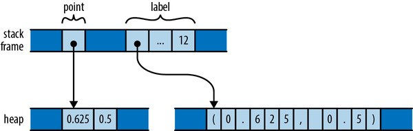
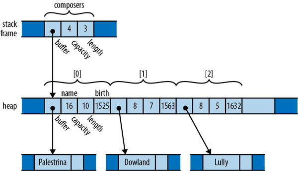
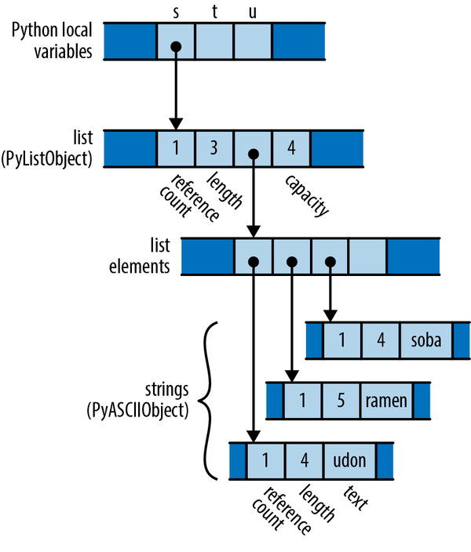
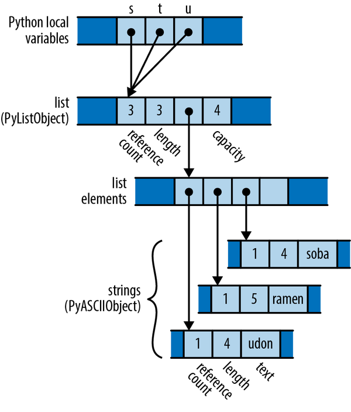
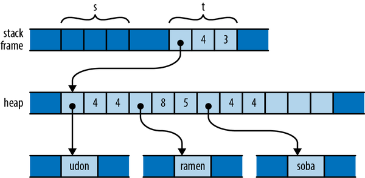

# Ownership and Moves

We want two things from **memory management**: to **free memory promptly** and on our own terms, and to **never use** a pointer to something **already freed**. The problem is these **conflict** 🤷, since freeing an object while pointers to it still exist leaves those pointers **dangling**. So most languages pick one:

- **Garbage-collected languages** (Python, JavaScript, C#, etc.) keep objects alive until nothing points to them, eliminating dangling pointers. The downside is you **lose control** over when memory is actually freed, and GC behavior can be hard to predict.
- **C and C++** leave freeing memory entirely to you, giving full control over memory use, but making dangling pointers your **responsibility**. In practice people make mistakes, and pointer misuse has been a persistent source of security bugs.

Rust wants to be both safe and fast, so neither compromise works. That meant something fundamental about memory management had to change 💡.

Rust resolves the safety-vs-control conflict by **restricting** how programs can use **pointers**. These restrictions bring just enough order that the compiler can verify memory safety at compile time, rather than relying on a GC at runtime. The key points:

- **Ownership tracking at compile time:** Rust **records** where **each value** is created and used and follows its **ownership** through the program. This prevents using **uninitialized** values, guarantees each value is **freed exactly once** (no double-frees), and only when it's no longer needed. The compiler also checks references to prevent dangling pointers.
- **No runtime cost:** Pointers are plain memory addresses at runtime, just like in C and C++. The difference is that the code has already been proven safe.
- **Safe concurrency for free:** The same ownership rules, combined with Rust's threading primitives, also prove code free of data races. One thread can't corrupt another's data, and nondeterminism is confined to tools explicitly built for it (mutexes, channels, atomics) rather than leaking into ordinary memory access.
- **Rust's wager:** The bet is that despite the restrictions, the language is flexible enough for nearly any task, and eliminating whole classes of memory and concurrency bugs is worth adjusting your coding style. The authors, with deep C/C++ experience, consider this an easy trade.

## Ownership

In C and C++, "ownership" is a **convention**: an object that owns another decides when to free it, and when the owner is destroyed, it takes its possessions with it. Consier the code below:

```cpp
std::string s = "frayed knot";
```

- A `std::string` is a small fixed-size object (three machine words: a pointer to a heap buffer, the buffer's capacity, and the current text length). The string **owns** that heap buffer, and its **destructor** frees it. Older libraries sometimes shared one buffer between strings via reference counting, but modern C++ rules out that design.
- Other code can create **temporary pointers** into the owned buffer, but it's that code's job to stop using them before the owner destroys the buffer. Once the string is gone, any pointer into it is invalid. The owner dictates the lifetime; everyone else must respect it.
- This is just a convention the standard library follows. C++ encourages the pattern but **doesn't enforce it**, so how you design your own types is **up to you**.

Rust's difference is that ownership is **built into the language** and enforced at **compile time**. Every value has **exactly one owner** that determines its **lifetime**, and when the owner is _dropped_ (Rust's term for freed), the owned value is dropped with it. The goal is that you can determine any value's lifetime just by reading the code, giving you the control a systems language should offer.

```rust
{
    let point = Box::new((0.625, 0.5));  // point allocated here
    let label = format!("{point:?}");    // label allocated here
    assert_eq!(label, "(0.625, 0.5)");
}
```

<p align="center"></p>

👉 **Stack-held variables** own their heap allocations, and dropping the variable automatically frees whatever it owns.

Just as variables own their values, **structs** and **tuples** own their **fields**, and **arrays** and **vectors** own their **elements**:

```rust
struct Person {
    name: String,
    birth: i32,
}

let mut composers = Vec::new();
composers.push(Person {
    name: "Palestrina".to_string(),
    birth: 1525,
});
composers.push(Person {
    name: "Dowland".to_string(),
    birth: 1563,
});
composers.push(Person {
    name: "Lully".to_string(),
    birth: 1632,
});
for composer in &composers {
    println!("{}, born {}", composer.name, composer.birth);
}
```

<p align="center"></p>

- The result is a chain of ownership:
  - `composers` owns the vector
  - the vector owns its `Person` elements
  - each `Person` owns its fields
  - the name field (a `String`) owns its text on the heap.

When composers goes out of scope, dropping it frees the entire structure at once, all the way down. Other collection types like `HashMap` or `BTreeSet` work exactly the same way.

Pulling the ownership rules together: every value has exactly one owner, but an owner can own many values, and those can own others in turn. The result is that ownership forms **trees**: your owner is your parent, what you own are your children, and the **root** of every tree is a **variable**. When that variable goes out of scope, the whole tree is dropped. Because of the single-owner rule, these structures can never rejoin into anything more complex than a tree.

A few consequences follow:

- **You rarely drop values explicitly.** Instead of `free` or `delete`, you remove a value from its ownership tree (let a variable go out of scope, remove an element from a vector, etc.) and Rust drops it along with everything it owns.
- **Rust is deliberately less powerful.** Other languages let you build arbitrary object graphs; Rust forbids that. But the simpler, tree-shaped relationships are exactly what make the compiler's safety analysis possible. This is part of the "radical wager": for most problems, at least a few good solutions fit within these restrictions.
- **Pure ownership is too rigid on its own,** so Rust adds four escape hatches that preserve its guarantees:
  - **Moves:** transfer a value from one owner to another, letting you build, rearrange, and tear down trees.
  - **`Copy` types:** simple values like integers, floats, and chars are exempt from ownership rules.
  - **`Rc` and `Arc`:** reference-counted pointers that allow multiple owners, with restrictions.
  - **References:** non-owning pointers with limited lifetimes that let you "borrow" a value.

## Moves

For most types in Rust, assigning a value to a variable, passing it to a function, or returning it from a function doesn't copy the value; it **moves** it. The source gives up ownership and becomes **uninitialized**, and the destination takes control of the value's lifetime. This is how Rust programs build up and tear down complex structures: one value and one move at a time.

Consider the following Python code:

```py
s = ['udon', 'ramen', 'soba']
t = s
u = s
```

Each Python object carries a **reference count**, tracking the number of values that are currently referring to it. So after the assignment to `s`, the state of the program looks like this:
<p align="center"></p>

Since only `s` is pointing to the list, the list’s reference count is 1; and since the list is the only object pointing to the strings, each of their reference counts is also 1.

What happens when the program executes the assignments to `t` and `u`? Python implements assignment simply by making the destination point to the same object as the source, and incrementing the object’s reference count
<p align="center"></p>

Assignment in **Python** is **cheap**, but because it creates a new reference to the object, we must maintain reference counts to know when we can free the value.

Now consider the analogous C‍++ code:

```cpp
using namespace std;
vector<string> s = { "udon", "ramen", "soba" };
vector<string> t = s;
vector<string> u = s;
```

Assigning a `std::vector` produces a **copy** of the vector in C‍++; `std::string` behaves similarly. So by the time the program reaches the end of this code, it has actually allocated three vectors and nine strings 🫤.

- **C++** assignment performs a **deep copy**, which can cost **unbounded memory** and **time** depending on the value. The upside is **clear ownership: when variables go out of scope, everything they allocated is freed automatically.
- **Python** makes assignment **cheap** (just sharing a reference), but pays for it with **reference counting** and, in general, garbage collection.

The two languages made opposite trade-offs: Python chose cheap assignment at the cost of memory management complexity, while C++ chose clear ownership at the cost of expensive copies. C++ programmers often dislike this, since deep copies are costly and better alternatives usually exist.

So what would the analogous program do in Rust? Here’s the code:

```rust
let s = vec!["udon".to_string(), "ramen".to_string(), "soba".to_string()];
let t = s;
let u = s;
```

But recall that, in Rust, **assignments** of most types **move** the value from the source to the destination, leaving the source uninitialized:
<p align="center"></p>

The initialization `let t = s`; moved the vector’s three header fields from `s` to `t`; now `t` owns the vector. The vector’s elements stayed just where they were, and nothing happened to the strings either. Every value still has a single owner, although one has changed hands. There were **no reference counts** to be adjusted. And the compiler now considers `s` **uninitialized**.

So what happens when we reach the initialization `let u = s;`? This would assign the uninitialized value `s` to `u`. Rust prudently prohibits using uninitialized values, so the compiler will reject it.

Rust’s move semantics get the best of both earlier approaches:

- **Cheap like Python**: assignment just moves the vector’s small three-word header from one place to another; nothing on the heap is copied.
- **Clear ownership like C++**: there’s always exactly one owner, so no reference counting or garbage collection is needed to know when to free the elements.

The trade-off is that copies are never implicit. If you actually want independent copies of a structure, you have to ask for them **explicitly** by calling `clone()`, which performs a deep copy of the vector and everything it contains.

```rust
let s = vec!["udon".to_string(), "ramen".to_string(), "soba".to_string()];
let t = s.clone();
let u = s.clone();
```

### More Operations That Move

Initialization and assignment differ slightly under move semantics:

- **Assigning to an already-initialized variable drops its old value first.** Moving `"Amiga500"` into `s` causes the prior `"C64"` to be dropped.
  ```rust
  let mut s = "C64".to_string();
  s = "Amiga500".to_string();  // value "C64" dropped here
  ```
- **But if the variable was already moved out of, nothing is dropped.** If `t` has taken ownership of `s`'s string, `s` is uninitialized by the time you assign to it, so there's no old value to drop.

```rust
let mut s = "C64".to_string();
let t = s;
s = "Amiga500".to_string();  // nothing is dropped here
```

👉 The key point is that moves aren't limited to `let` **statements** and **assignment**. Rust applies move semantics to nearly **every use of a value**: passing arguments moves ownership into the function's parameters, returning a value moves it to the caller, building a tuple moves values into the tuple, and so on.

For example, when we were constructing our vector of composers, we wrote:

```rust
struct Person {
    name: String,
    birth: i32,
}

let mut composers = Vec::new();
composers.push(Person {
    name: "Palestrina".to_string(),
    birth: 1525,
});
```

Revisiting the `composers` example shows moves happening in several places beyond plain assignment:

- **Returning from a function:** `Vec::new()` returns the vector itself (not a pointer), moving ownership to `composers`. Likewise, `to_string()` returns a fresh `String`.
- **Constructing values:** the new `Person` takes ownership of the `String` returned by `to_string()` when its `name` field is initialized.
- **Passing to a function:** the whole `Person` struct is moved into `push`, which moves it onto the end of the vector. The vector now owns the `Person`, and indirectly its name `String` too.

All this moving might sound expensive, but two things keep it cheap:

1. Moves only touch the **value proper**, not the heap storage it owns. For vectors and strings that's just the three-word header; the large buffers stay put on the heap.
2. The compiler is good at **seeing through moves**, often generating machine code that writes the value directly to its final destination.

### Moves and Control Flow

If there is any path through the code where the value could have been moved out, and nothing has definitely put a new value back since, the variable counts as empty and you can’t use it.

```rust
let x = vec![10, 20, 30];
if c {
    f(x);   // ok to move from x here
}
h(x);       // bad: x may have been moved
```

For similar reasons, moving from a variable in a loop is forbidden:

```rust
let x = vec![10, 20, 30];
while f() {
    g(x);  // bad: x would be moved in first iteration,
           // uninitialized in second
}
```

That is, unless we’ve definitely given it a new value by the next iteration:

```rust
let mut x = vec![10, 20, 30];
while f() {
    g(x);           // move from x
    x = h();        // give x a fresh value
}
e(x);
```

### Moves and Indexed Content

A move leaves its source uninitialized, but not every owner can afford that. **Indexing** a **vector** is the key example: `let third = v[2]`; is **rejected** because Rust would have to track which individual elements are live and which have been moved out, and a vector would need to carry that extra bookkeeping around. That’s wrong for a systems language, where a vector should be nothing but a vector 🫤.

The compiler suggests borrowing instead (`&v[2]`), which is usually what you want. But if you really do need to move an element out, you must use a method that leaves the vector fully populated afterward:

- **`pop()`** moves the last element off the end.
- **`swap_remove(i)`** moves out the element at `i` and fills the gap with the last element.
- **`std::mem::replace(&mut v[i], new_value)`** moves out the element at `i` and puts a substitute in its place.

Each of these takes ownership of an element while leaving the vector in a consistent state, possibly shorter but with no holes.

Collection types like `Vec` also generally offer methods to **consume all their** elements in a loop:

```rust
let v = vec![
    "liberté".to_string(),
    "égalité".to_string(),
    "fraternité".to_string(),
];

for mut s in v {
    s.push('!');
    println!("{s}");
}
```

When we pass the vector to the loop directly, as in `for ... in v`, this moves the vector out of `v`, leaving `v` uninitialized. The `for` loop’s internal machinery takes ownership of the vector and dissects it into its elements. At each iteration, the loop moves another element to the variable `s`. Since `s` now owns the string, we’re able to modify it in the loop body before printing it. And since the vector itself is no longer visible to the code, nothing can observe it **mid-loop** in some **partially emptied state**.

When the compiler **can't track** whether a value has been moved out of its owner, one solution is to change the owner's type so it can track that itself at runtime. `Option` is the standard tool for this.

The example changes `Person`'s `name` field from `String` to `Option<String>`:

```rust
struct Person {
    name: Option<String>,
    birth: i32,
}
```

- `let first_name = composers[0].name;` still fails with the same "cannot move out of index" error, since you'd be leaving a hole.
- But because `None` is now a legitimate value for the field, you can swap it in: `std::mem::replace(&mut composers[0].name, None)` moves the original `Some("Palestrina")` out to the caller and leaves `None` behind. The struct remains fully valid; it just explicitly holds "no name" now.

This pattern is so common that `Option` has a dedicated method for it: `composers[0].name.take()` does exactly the same thing as the `replace` call, just more readably.

👉 Instead of asking the compiler to remember that a slot is empty, you make "empty" a real, representable state of the type, so there's never an uninitialized hole.

## Copy Types: The Exception to Moves

Moves make sense for types like `String` and `Vec` that own **heap** memory, but they'd be pointless for simple values like **integers**. Rust handles this with **`Copy` types**, the exception to move semantics.

Assigning `string1` to `string2` moves it, so two strings never **share responsibility** for **freeing** the same buffer. An `i32` is just a bit pattern with no resources behind it. Copying its bits produces a fully independent value, so there's no reason to leave the source **uninitialized**. Treating `num1` as moved-out would be inconvenient with no safety benefit.

**How `Copy` types behave:** assignment copies the value instead of moving it, and the source stays initialized and usable. Passing them to functions and constructors works the same way.

**Which types are `Copy`:** all integer and floating-point types, `char`, `bool`, and a few others. Tuples and fixed-size arrays made entirely of `Copy` types are also `Copy`.

**Which types can't be:** only types where a plain bit-for-bit copy is sufficient. `String` and `Box<T>` own heap allocations; `File` wraps an OS handle that can't just be duplicated; `MutexGuard` represents a lock that only one thread can hold. The rule of thumb 🧠: **any type that must do something special when dropped cannot be `Copy`**, because duplicating its bits would make it unclear which copy is responsible for releasing the resource.

User-defined `struct` and `enum` types are **not `Copy` by default**, even when they're trivially simple ⚠️.

```rust
struct Label {
    number: u32,
}

fn print_label(l: Label) {
    println!("STAMP: {}", l.number);
}

let l = Label { number: 3 };
print_label(l);
println!("My label number is: {}", l.number);
```

The example shows the consequence: `Label` is just a wrapper around a `u32`, but passing `l` to `print_label` moves it into the function, which drops it on return. Using `l` afterward is then a compile error ("borrow of moved value").

If every field of your struct is itself `Copy`, you can make the whole type `Copy` by adding `#[derive(Copy, Clone)]` above the definition. With that, the `Label` example compiles and `l` stays usable after the call.

This only works when all fields are `Copy`. Trying to derive `Copy` on a struct containing a `String` fails, with the compiler pointing at the offending field. The same rule from before applies: if any part of the type owns a resource that needs special handling on drop, the type can't be bit-copied 🫤.

**Why `Copy` is opt-in:** Being `Copy` is a trade-off between **users** and **implementers** of a type. For users, `Copy` types are more flexible since assignment doesn't invalidate the source. For the implementer, it's restrictive: `Copy` types can't contain heap allocations or own resources. So declaring a type `Copy` is a real commitment. If you later need to add a `String` field and drop `Copy`, much of the code using your type will break. Rust makes you choose explicitly rather than committing you by default.

**No customizable moves or copies:** Unlike C++, where you can **overload assignment** and write **custom copy/move** constructors, Rust allows no such customization. Every move is a shallow, byte-for-byte copy that leaves the source uninitialized; a copy is the same but leaves the source intact. This means C++ classes can offer conveniences Rust can't, like ordinary-looking assignments that quietly adjust reference counts or defer expensive copies.

🧠 C++ flexibility makes basic operations **unpredictable** in **cost**. Rust's rule is that **costs should be apparent**: fundamental operations stay simple and cheap, and anything potentially expensive (like a deep copy) must be **explicit**, as with calling `clone()`.

Finally, `Copy` and `Clone` aren't just loose descriptions; they're **traits**, Rust's mechanism for categorizing types by what operations they support. Later chapters cover traits generally and these two specifically.

## Rc and Arc: Shared Ownership

Sometimes a value can't reasonably have a single owner with the right lifetime; you just want it to live until everyone is done with it. For these cases Rust provides the reference-counted pointer types **`Rc` and `Arc`**.

Unlike reference counting in C++, these are fully safe: you can't forget to update the count, create untracked pointers to the referent, or hit the other classic pitfalls 🤓.

The only difference between the two:

- **`Rc`** uses fast, non-thread-safe code to update its count. Use it when the pointer stays on one thread.
- **`Arc`** (atomic reference count) is safe to share across threads, at a small performance cost.

Pick `Rc` unless you need to cross threads; Rust won't let you accidentally send an `Rc` to another thread anyway. Since they're otherwise identical, the rest of the section only discusses `Rc`.

`Rc<T>` gives Rust a Python-style reference-counted value: a pointer to a heap-allocated `T` with a reference count attached.

- Cloning an `Rc` doesn't copy the `T`; it just creates another pointer and bumps the count. In the example, `s`, `t`, and `u` all point to the same `String`.
- The `Rc` pointers themselves follow normal ownership rules. When the last one is dropped, the count hits zero and the `String` is freed.
- You can call the referent's methods directly on the `Rc` (e.g. `s.contains(...)`).

`Rc` contents are **immutable**: Trying `s.push_str(...)` fails to compile. Rust's safety guarantees rest on never letting a value be **both shared and mutable at once**, and since an `Rc`'s referent might be shared, it can't be mutated.

**Reference cycles:** the classic weakness of reference counting is that two values pointing at each other keep each other alive forever, **leaking memory**. This is possible in Rust but rare, because creating a cycle requires making an older value point to a newer one, which needs **mutability**, and `Rc` forbids that. It can only happen if you combine `Rc` with _interior mutability_ (covered later). Weak pointers (`std::rc::Weak`) can help avoid cycles.

👉 Moves and reference-counted pointers are two ways to **loosen** the ownership 🌴. The third, **borrowing references**, is the subject of the next chapter.
